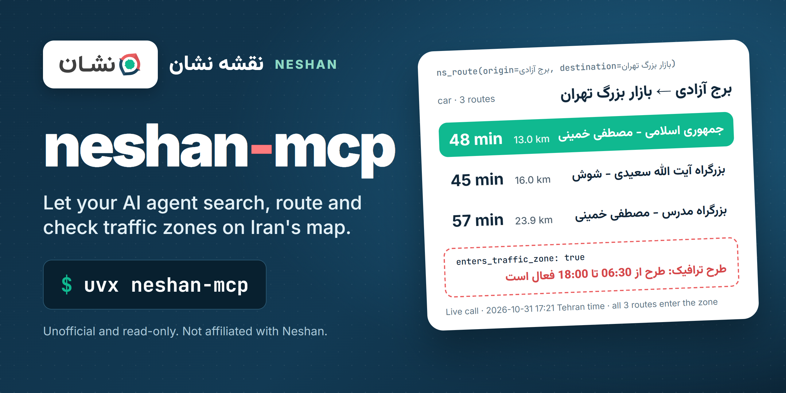

<!-- mcp-name: io.github.sepehr071/neshan-mcp -->

<div align="center">



# neshan-mcp: Neshan map of Iran MCP server for AI agents

**Let your AI agent search places, get directions and check Tehran's traffic zones on Neshan (نشان).**<br>
`neshan-mcp` is an unofficial, read-only MCP server for [Neshan](https://neshan.org/maps), the Iranian map and navigation app.<br>
Its 11 tools cover place search, place details, reviews, photos and menus, nearby places, reverse geocoding, city air quality,
car, motorcycle, bicycle, walking and bus/metro directions, travel times to several places and Tehran traffic-zone checks.
No API key or account is needed.

[](https://pypi.org/project/neshan-mcp/)
[](https://pypi.org/project/neshan-mcp/)
[](https://github.com/sepehr071/neshan-mcp/actions/workflows/ci.yml)
[](https://registry.modelcontextprotocol.io/?q=neshan-mcp)
[](https://github.com/sepehr071/neshan-mcp/blob/main/LICENSE)

[](https://vscode.dev/redirect/mcp/install?name=neshan&config=%7B%22command%22%3A%22uvx%22%2C%22args%22%3A%5B%22neshan-mcp%22%5D%7D)

[For AI agents](#for-ai-agents) · [Quick start](#quick-start) · [What it can do](#what-it-can-do) · [Tools](#tools) · [FAQ](#faq) · [فارسی](#فارسی)

</div>

---

## For AI agents

- **What:** unofficial MCP server (model context protocol) for neshan.org/maps, the Neshan map of Iran. Queries can be Persian or English; answers keep Neshan's Persian names, addresses and steps.
- **Install:** `uvx neshan-mcp` or `claude mcp add neshan -- uvx neshan-mcp`. Transport: stdio. Needs [uv](https://docs.astral.sh/uv/getting-started/installation/) (Python 3.10+).
- **Auth:** none, no API key or account. Optional `NESHAN_MCP_PROXY` (HTTP proxy URL, or a comma-separated list); system proxy settings are ignored.
- **Access:** read-only. It cannot log in, save places or post reviews, so no confirmation is needed before calling any tool.
- **Tools:** 11, all prefixed `ns_`. Typical sequences: `ns_search` -> `ns_place` / `ns_reviews` / `ns_photos` / `ns_nearby`;
  `ns_search` -> `ns_travel_times` -> `ns_route`; `ns_zone_check` before driving into central Tehran.
- **Use when:** the user asks where something is in Iran, what is near a place, whether a business is open, what people say about it or what its menu looks like, what address a coordinate is, how polluted a city's air is, whether an address is inside Tehran's traffic zone, or how to get from A to B and how long it takes, now or at a given time.
- **Do not use when:** the user wants places outside Iran, taxi or delivery prices, or to save places in a Neshan account.
- **Output:** compact JSON. Coordinates are `lat,lng` (latitude first). Distances in metres or km, times in minutes, fares in Toman, review dates in the Persian calendar, departure times in Tehran time.
- **Network:** every tool works from an Iranian connection. Through a foreign connection all tools worked in testing except `ns_nearby`, which Neshan answers with HTTP 403; set `NESHAN_MCP_PROXY` to an Iranian proxy for it.
- **Machine-readable:** [`server.json`](https://github.com/sepehr071/neshan-mcp/blob/main/server.json) and the
  [iran-mcp catalog](https://github.com/sepehr071/iran-mcp).

## Why

Neshan knows Iran in detail: businesses with opening hours and reviews, live traffic, Tehran's traffic and odd-even
plans, bus, BRT and metro lines. Its developer API needs a paid key, and its web map is built for clicking.
`neshan-mcp` gives an agent the same public data the web map shows any visitor, in a few small calls:

> **You:** How long does it take to drive from Azadi Tower to the Tehran Grand Bazaar, and will I enter the traffic zone?
>
> **Agent:** *calls* `ns_search("برج آزادی")`, `ns_search("بازار بزرگ تهران")`, then
> `ns_route(origin="35.699739,51.338097", destination="35.671897,51.422428", steps=false)`
>
> Neshan suggests 48 minutes (13 km) via Jomhouri-e Eslami and Mostafa Khomeini streets; the route via Saeedi
> expressway and Shoush is 16 km and takes 45 minutes. All three routes enter the traffic-plan zone (طرح ترافیک)
> and the odd-even zone, which run from 06:30 to 18:00. The bazaar itself is inside both zones.

<sub>Real answer from a live call on 2026-10-31 at 17:21 Tehran time; times change with traffic.</sub>

Every reply is compact JSON with only the fields that matter, so it does not flood the agent's context.

## What it can do

- **Find places** by name or category near a city or a point: cafes, pharmacies, petrol stations, streets, squares. Filter by open now and rating, the way the site does
- **Read a place**: address, coordinates, phones, website, rating and votes, open now, hours for each weekday, newest photos
- **Read reviews**, newest first or the ones Neshan features, and **browse photos**, including the menu album
- **See what is nearby**: restaurants, cafes, parks, toilets, banks, ATMs, parking and bus stops around a place
- **Reverse geocode** a coordinate into a street address and province
- **Check air quality**: today's AQI of a city, its pollutants and every monitoring station, or the index at a point
- **Get directions** by car, motorcycle, bicycle or on foot: alternatives, live travel time, Persian turn-by-turn steps, up to 3 stops
- **Plan by time**: leave at a given time or arrive by one (car, Tehran, Karaj and Mashhad), with Neshan's traffic forecast
- **Rank by travel time**: one origin to up to 10 places, fastest first
- **Check Tehran's zones**: is a point inside the traffic-plan zone or the odd-even zone, and does a route enter them; avoid them or toll roads
- **Take public transport**: bus, BRT and metro options with lines, stops, walking and fares in Toman
- **Read-only by design**: no login, no saving, no posting

Example prompts:

- "Find 24-hour pharmacies near Milad Tower that are open now and rated 4 or more."
- "Is Lamiz Coffee in Gisha open now? What's its phone number, and what do people say about it?"
- "Show me the menu photos of Milad Tower."
- "Which of these three branches is closest by car from Azadi Square?"
- "I need to be at Milad Tower at 9 tomorrow. When should I leave from Azadi Square?"
- "Is Ferdowsi Square inside Tehran's traffic zone?"
- "How polluted is the air in Isfahan today?"
- <span dir="rtl">نزدیک‌ترین داروخانه شبانه‌روزی به برج میلاد کجاست؟</span>
- <span dir="rtl">از میدان آزادی تا بازار تهران با ماشین چقدر راه است؟ وارد طرح ترافیک می‌شوم؟</span>
- <span dir="rtl">با مترو و اتوبوس از میدان آزادی به برج میلاد چطور بروم و هزینه‌اش چقدر است؟</span>

## Quick start

You need [uv](https://docs.astral.sh/uv/getting-started/installation/). No API key or account.

<details open>
<summary><b>Claude Code</b></summary>

```bash
claude mcp add neshan -- uvx neshan-mcp
```
</details>

<details>
<summary><b>Claude Desktop</b></summary>

Settings → Developer → Edit Config, then add:

```json
{
  "mcpServers": {
    "neshan": { "command": "uvx", "args": ["neshan-mcp"] }
  }
}
```
</details>

<details>
<summary><b>Cursor</b></summary>

Add the Claude Desktop block above to `~/.cursor/mcp.json` (or `.cursor/mcp.json` in a project).
</details>

<details>
<summary><b>VS Code (Copilot agent mode)</b></summary>

Click **Install in VS Code** above, or add to `.vscode/mcp.json`:

```json
{
  "servers": {
    "neshan": { "type": "stdio", "command": "uvx", "args": ["neshan-mcp"] }
  }
}
```
</details>

<details>
<summary><b>Codex CLI</b></summary>

```bash
codex mcp add neshan -- uvx neshan-mcp
```

Or in `~/.codex/config.toml`:

```toml
[mcp_servers.neshan]
command = "uvx"
args = ["neshan-mcp"]
```
</details>

<details>
<summary><b>Gemini CLI</b></summary>

Add to `~/.gemini/settings.json`:

```json
{
  "mcpServers": {
    "neshan": { "command": "uvx", "args": ["neshan-mcp"] }
  }
}
```
</details>

<details>
<summary><b>Windsurf</b></summary>

Add the Claude Desktop block to `~/.codeium/windsurf/mcp_config.json`.
</details>

<details>
<summary><b>Anything else</b></summary>

It is a standard stdio MCP server: run `uvx neshan-mcp`, or `pip install neshan-mcp` and run `neshan-mcp`.
</details>

## Tools

Points are `lat,lng`, e.g. `35.6997,51.3380`. Place ids come from `ns_search`.

| Tool | What it does |
|---|---|
| `ns_search` | Find places, businesses, streets and squares on the Neshan map by name or category near a city or point |
| `ns_place` | Get one place's details on Neshan: address, coordinates, phones, website, rating, opening hours and photos |
| `ns_reviews` | List visitors' reviews of a place on Neshan: star rating, Persian date, comment, likes and owner reply |
| `ns_photos` | List a place's photos on Neshan as image URLs, 10 per page, with date and uploader, including menu photos |
| `ns_nearby` | List what is around a place on Neshan by category: restaurants, cafes, parks, toilets, banks, ATMs, parking |
| `ns_reverse_geocode` | Turn a latitude/longitude into Neshan's street address and province (reverse geocoding) |
| `ns_air_quality` | Get today's air quality index (AQI) of an Iranian city from Neshan, with pollutants and the readings of each station |
| `ns_route` | Get car, motorcycle, bicycle or walking directions on Neshan: distance, travel time and turn-by-turn steps |
| `ns_travel_times` | Get the travel time from one point to several places on Neshan, fastest first |
| `ns_zone_check` | Check whether a point is inside Tehran's traffic-plan zone or odd-even (air-pollution) zone, with plan hours |
| `ns_transit_route` | Get bus, BRT and metro options between two points on Neshan, with lines, stops, walking and fares |

All 11 tools are annotated `readOnlyHint: true`.

## How it works

```text
  AI agent  (Claude, Cursor, Copilot, ...)
      │
      │  MCP over stdio
      ▼
  neshan-mcp  (runs on your machine)
      │
      │  HTTPS
      └──────▶  neshan.org/maps/pwa-api   search, places, reviews, photos, routes, transit, air quality
```

`neshan-mcp` runs locally and calls the same endpoints the neshan.org/maps web app uses, with no hosted server in
between and no API key. Requests go out through a Chrome-impersonating client and look like the web app's own.
It sends at most 3 requests at a time with a little jitter, caches answers (places and addresses for 5 minutes,
live routes for 1 minute, transit, zones and air quality for 10 minutes), retries a failed call up to twice, and
only talks to `neshan.org`.

Neshan's web app encodes most of its answers: they arrive as shuffled base64 text, and transit answers are also
XOR-encoded. The server decodes them the same way the web app's own script does. If Neshan changes the scheme, the
server reads the new values from the site's current JavaScript once, the way a browser loads it, and retries. An
answer it still cannot read is reported as an error, never as made-up data.

## Good to know

- **Coordinates are `lat,lng`.** Latitude first. A swapped pair is rejected with a hint.
- **`near` takes a city or a point.** 23 big cities by name in English or Persian (Tehran, Mashhad, Isfahan, Shiraz,
  Tabriz, Karaj, Qom, Ahvaz, ...). For a smaller town, put its name in the query.
- **Search returns at most 30 places**, with no paging. Sponsored results (marked آگهی on the site) are left out.
  `open_now` and `min_rating` use Neshan's own filters (open now; 3.5+, 4+, 4.5+).
- **Travel times are Neshan's estimates** for leaving now, or for `depart_at`. Departure and arrival times are
  Tehran time (`YYYY-MM-DD HH:MM`, Gregorian); Neshan offers them for cars in Tehran, Karaj and Mashhad.
- **Toll roads are flagged** (`toll_road`), but not priced: Neshan's web app never shows a toll amount.
- **Transit has no travel time.** Neshan's web map gives fares, lines and stops, but no duration, for bus and metro.
- **`ns_nearby` needs an Iranian connection.** Neshan answers it with HTTP 403 from abroad; set `NESHAN_MCP_PROXY`
  to an Iranian proxy, or use `ns_search` with the place's `lat,lng` as `near`.
- **Air-quality cities** use their English name (`Tehran`, `bandar abbas`) or the Persian name for the 23 cities above.
  A city without monitoring stations returns "no data".
- **Persian output.** Names, addresses, hours (Persian digits), steps and review dates are as Neshan shows them.
- **What it does not do:** no login, saving or reviewing; no places outside Iran; no live traffic incidents; no
  temperature or AI review summaries (Neshan serves those only to signed-in users).

## FAQ

<details>
<summary><b>Is there a Neshan MCP server or a free Neshan API?</b></summary>

Neshan sells a developer API that needs an API key. `neshan-mcp` is an unofficial MCP server with 11 read-only
tools that calls the public endpoints of the neshan.org web map instead, so it needs no key, account or payment.
</details>

<details>
<summary><b>Does it need a Neshan API key?</b></summary>

No. It uses no API key, token or login. Install it with `uvx neshan-mcp` and ask in plain language.
</details>

<details>
<summary><b>Is my car allowed in Tehran's traffic zone right now?</b></summary>

`ns_zone_check` tells you whether a point is inside the traffic-plan zone (طرح ترافیک) or the odd-even zone (طرح
آلودگی هوا) and the hours Neshan shows for each plan, e.g. 06:30 to 18:00. Whether your own car may enter depends on
your permit and plate, which the server does not know. `ns_route` can route around both zones with
`avoid_traffic_zone` and `avoid_odd_even`.
</details>

<details>
<summary><b>What is Tehran's air quality today?</b></summary>

Ask the agent; `ns_air_quality("Tehran")` returns today's AQI on the 0-500 scale with Neshan's label (e.g. قابل قبول,
acceptable), the pollutant readings and every monitoring station, most polluted first.
</details>

<details>
<summary><b>How do I use it with Claude, Cursor or Copilot?</b></summary>

Add the server with `claude mcp add neshan -- uvx neshan-mcp`, or use the matching config in
[Quick start](#quick-start), then ask in Persian or English.
</details>

<details>
<summary><b>Does it work outside Iran?</b></summary>

Yes, except for `ns_nearby`. Everything else worked through a foreign connection in testing. If your network is
blocked, set `NESHAN_MCP_PROXY` to an HTTP proxy. System proxy variables are ignored on purpose.
</details>

<details>
<summary><b>How is it different from balad-mcp?</b></summary>

[balad-mcp](https://github.com/sepehr071/balad-mcp) reads Balad, another Iranian map. Both search places and give
directions; `neshan-mcp` adds bicycle, walking and public-transit routes, departure-time routing, a zone check for any
point in Tehran and air quality. You can install both and compare.
</details>

<details>
<summary><b>Can it save places or write reviews?</b></summary>

No. It has no login and only reads public data.
</details>

<details>
<summary><b>How do I debug what the agent sees?</b></summary>

```bash
npx @modelcontextprotocol/inspector uvx neshan-mcp
```
</details>

## Configuration

| Variable | Default | Meaning |
|---|---|---|
| `NESHAN_MCP_PROXY` | unset | Optional HTTP proxy URL for the neshan.org requests; system proxy settings are ignored. A comma-separated list is used one at a time: the next proxy takes over when one is blocked or cannot connect |

<a id="فارسی"></a>

## فارسی: سرور MCP نقشه نشان

<div dir="rtl">

**neshan-mcp** یک سرور MCP غیررسمی و فقط‌خواندنی برای [نقشه نشان](https://neshan.org/maps) است. با آن دستیار هوش مصنوعی شما (Claude، Cursor، Copilot و برنامه‌های دیگر) می‌تواند مکان‌ها را پیدا کند، مسیر بدهد و محدوده طرح ترافیک تهران را بررسی کند. کلید API و حساب کاربری لازم نیست.

**چه کارهایی می‌کند**

- **جستجوی مکان** با نام یا دسته (کافه، داروخانه، پمپ بنزین، خیابان، میدان) در یک شهر یا نزدیک یک نقطه، با فیلتر «باز باشد» و امتیاز، همان‌طور که در سایت نشان است.
- **جزئیات مکان**: آدرس، مختصات، تلفن، وب‌سایت، امتیاز، ساعت کاری هر روز هفته و تازه‌ترین عکس‌ها.
- **نظرات کاربران** (تازه‌ترین یا برگزیده) و **عکس‌ها**، از جمله عکس منو.
- **امکانات نزدیک** هر مکان: رستوران، کافه، پارک، سرویس بهداشتی، بانک، خودپرداز، پارکینگ و ایستگاه اتوبوس.
- **تبدیل مختصات به آدرس**.
- **کیفیت هوا**: شاخص امروز هر شهر، آلاینده‌ها و همه ایستگاه‌های سنجش.
- **مسیریابی** با خودرو، موتور، دوچرخه و پیاده، با زمان سفر زنده، گام‌های مسیر به فارسی و تا ۳ توقف بین راه.
- **مسیریابی با زمان حرکت یا رسیدن** برای خودرو در تهران، کرج و مشهد، با پیش‌بینی ترافیک نشان.
- **مقایسه زمان سفر** از یک مبدا تا حداکثر ۱۰ مقصد، از سریع‌ترین به کندترین.
- **طرح ترافیک و زوج و فرد**: آیا یک نقطه داخل محدوده است و آیا مسیر وارد آن می‌شود، با امکان دور زدن محدوده‌ها و عوارضی.
- **حمل‌ونقل عمومی**: گزینه‌های اتوبوس، بی‌آرتی و مترو با خط‌ها، ایستگاه‌ها و هزینه سفر به تومان.

**نکته‌ها**

- فقط‌خواندنی است: وارد حساب نمی‌شود، مکانی ذخیره نمی‌کند و نظر ثبت نمی‌کند.
- مختصات را به شکل `lat,lng` بدهید، یعنی اول عرض جغرافیایی (مثل `35.6997,51.3380`).
- ابزار امکانات نزدیک (`ns_nearby`) فقط با اینترنت ایران کار می‌کند. بیرون از ایران متغیر `NESHAN_MCP_PROXY` را روی یک پراکسی با خروجی ایران بگذارید.
- زمان حرکت و رسیدن به وقت تهران و تاریخ میلادی است (مثل `2026-11-01 08:00`).
- برای مسیرهای عوارضی فقط نشانه عوارضی بودن برمی‌گردد، چون خود سایت نشان مبلغ عوارض را نمایش نمی‌دهد.
- پاسخ‌های سایت نشان رمزگذاری‌شده است و این سرور آن‌ها را به همان روشی باز می‌کند که خود سایت باز می‌کند.

**نصب** (اول [uv](https://docs.astral.sh/uv/getting-started/installation/) را نصب کنید). در Claude Code:

</div>

```bash
claude mcp add neshan -- uvx neshan-mcp
```

<div dir="rtl">

در Claude Desktop، Cursor و برنامه‌های دیگر همان تنظیم بخش [Quick start](#quick-start) را بگذارید.

**نمونه پرسش‌ها**

- «نزدیک‌ترین داروخانه شبانه‌روزی به برج میلاد کجاست و الان باز است؟»
- «از میدان آزادی تا بازار تهران با ماشین چقدر طول می‌کشد؟ وارد طرح ترافیک می‌شوم؟»
- «فردا ساعت ۹ باید برج میلاد باشم؛ کی از میدان آزادی راه بیفتم؟»
- «با مترو و اتوبوس از میدان آزادی به برج میلاد چطور بروم و چقدر خرج دارد؟»
- «هوای اصفهان امروز آلوده است؟»
- «کافه لمیز گیشا الان باز است؟ مردم درباره‌اش چه گفته‌اند؟»

</div>

## Development

```bash
git clone https://github.com/sepehr071/neshan-mcp && cd neshan-mcp
uv sync
uv run ruff check . && uv run ruff format --check .
uv run python -m pytest -q          # offline unit tests
uv run python -m pytest -m live -q  # calls neshan.org
uv build
```

Place tools live in `src/neshan_mcp/maps.py`, routing tools in `src/neshan_mcp/routes.py` and the decoding of
Neshan's answers in `src/neshan_mcp/codec.py`. Each tool is a typed async function with a docstring that tells the
agent when to use it. Issues and PRs are welcome.

Releases: bump the version in `pyproject.toml` and `server.json`, then push a `v*` tag. GitHub Actions publishes to PyPI.

## Related servers

- [balad-mcp](https://github.com/sepehr071/balad-mcp) for Balad, another Iranian map: places, reviews and driving routes
- [iran-mcp](https://github.com/sepehr071/iran-mcp): catalog of all Iranian-service MCP servers
- [mrbilit-mcp](https://github.com/sepehr071/mrbilit-mcp) for Iranian flights, trains, buses and hotels
- [jabama-mcp](https://github.com/sepehr071/jabama-mcp) for villas and stays across Iran
- [snapp-mcp](https://github.com/sepehr071/snapp-mcp) for Snappfood and SnappMarket

## Disclaimer

Unofficial and not affiliated with or endorsed by Neshan. It is read-only and uses the endpoints of the neshan.org
web app, which can change without notice. Travel times, zone hours and air quality are informational; check
official sources before relying on them.

## Author

<a href="https://www.linkedin.com/in/sepehr-radmard"></a>

Built and maintained by **Sepehr Radmard** (سپهر رادمرد). Connect on [LinkedIn](https://www.linkedin.com/in/sepehr-radmard) or follow [@sepehr071 on GitHub](https://github.com/sepehr071) for more MCP servers for Iranian websites, all listed in [iran-mcp](https://github.com/sepehr071/iran-mcp). If this saves you time, a star on the repo helps other people find it.

## License

[MIT](https://github.com/sepehr071/neshan-mcp/blob/main/LICENSE)
